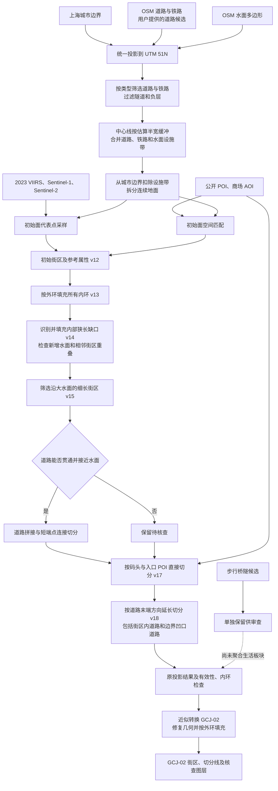

# 上海街区划分 PoC 制作方法

更新时间：2026 年 11 月 19 日。本文记录当前交付的 v18 做法与实际结果。目标是形成贴近道路、铁路、水系和实际地理环境的上海街区面，并为后续商业和居民活动分析提供基础。当前版本是街区几何 PoC，生活板块聚合和实地验收仍在进行之外。

## 1. 数据与坐标

- 上海城市边界用于确定处理范围。边界输入按 WGS84 假定，来源坐标尚未独立校验。
- 现有 OSM 道路、铁路、POI、商场 AOI 和水面；另加入用户提供的 2025 年全国道路中经差异筛选的 1,168 条候选。提供的铁路差异和分级河流线主要作为核查参考，未整体加入最终硬阻隔。
- 2023 年 VIIRS 夜间灯光、Sentinel-1 VV 和 Sentinel-2 NDVI/NDBI，用作街区背景信息。影像与 2025 年补充道路、2026 年 OSM 的时间不一致。分辨率和缺测约束不支持把影像采样当作地块级真实用途。
- 面积、距离和几何运算使用 EPSG:32651。地图交付使用近似转换的 GCJ-02。GCJ-02 GeoJSON 不能直接当作 WGS84/EPSG:4326 作常规重投影。

## 2. 道路、铁路和水系的基础切分

从城市范围出发构造设施带并扣除，剩余连续区域作为初始街区。道路源主要是中心线，按下表每侧估算缓冲，宽度并非实测道路红线。

| 道路类型 | 数据类型 | 每侧宽度 |
| --- | --- | ---: |
| 高速 / 高速连接线 | motorway / motorway_link | 15 / 8 米 |
| 快速路 / 连接线 | trunk / trunk_link | 12 / 7 米 |
| 主干路 / 连接线 | primary / primary_link | 9 / 6 米 |
| 次干路 / 连接线 | secondary / secondary_link | 7 / 5 米 |
| 三级道路 / 连接线 | tertiary / tertiary_link | 6 / 5 米 |
| 居住区道路 / 未分类道路 | residential / unclassified | 4 / 4 米 |

桥梁及高架道路在所选类别内纳入地面投影。标记为隧道或负层的线不作为地面阻隔。居住区道路不一定在封闭小区内；unclassified 不是统一的行政道路级别。service、living_street、track、步道、自行车道不用于本轮基础道路切分。

地面及高架铁路、轻轨、有轨电车、单轨、窄轨、缆索铁路以及标记高架的地铁，按中心线每侧 5 米估算；隧道和负层排除。水面使用已有 OSM water、riverbank、reservoir、dock 多边形。提供的分级河流线与现有水系的表达和位置有差异，因此没有自动作为精确水面边界。

## 3. 初始面上的属性

从城市范围重建后，v12 生成 48,816 个初始面。统计落入每个面的公开 POI 和商场 AOI 代表点，并按街区代表点采样 VIIRS、Sentinel-1 VV、Sentinel-2 NDVI/NDBI。510 个商场代表点与初始面匹配。POI 数量和商场点是候选识别证据，并非独立商业召回率验证；影像取样是单点所在像元，而非整面均值。

之前尝试过按道路相邻关系和商业锚点构建活动区域，并保留人行桥隧候选。当前 v18 街区图层没有经过完整入口、步行网络验证或生活板块聚合，不能把桥隧候选当成已验证的通行关系。

## 4. 外环填充和狭长缺口处理

v13 使用 v12 初始面，按每个面的外环生成 Polygon，删除全部内环。1,199 个街区的 3,647 个内环被填充，新增约 45.87 平方公里。原本位于镂空内的水面、设施或其他街区因此可能被包含；检查到 346 对面积重叠，各对交叠面积之和约 6.06 平方公里，未按区域去重。

v14 对外环填充后的街区进行 10 米尺度几何闭合，筛选面积至少 50 平方米、长度至少 20 米且较狭长的新增缺口面，尝试并入原街区。共处理 11,150 处候选、涉及 5,882 个街区，新增约 21.46 平方公里。它是几何近似，不是逐条验证的道路通达关系。新增候选若与水面或其他街区发生面积重叠，或者无法保持单面无洞，则跳过。保留新增面图层供复核。填充可能重新包含原先扣除的道路等设施；v13 已有重叠没有被修复。

## 5. 沿水细长面的切分

v15 从 v14 原投影结果筛选沿较大水面的细长面。筛选条件是面积至少 0.1 平方公里、最小旋转外接矩形长边至少 800 米、长宽比至少 4，且边界距较大水面不超过 50 米。较大水面使用 OSM riverbank 及面积至少 10 万平方米的 water，范围可能包括湖泊，不等同于准确沿江分类。

在候选面中裁剪所选地面道路并拼接相交路段。道路端点距面边界不超过 20 米、至少一端距水面不超过 50 米时，尝试以道路及端点短连接切分；任何切分产生的面小于 5,000 平方米时不采纳。端点短连接是估算，最长 20 米，需要人工复核；当前规则没有全面识别支流、公园及园区边界。

共筛得 313 个候选，其中 11 个原面被切分、产生 11 条切分线，其余 302 个保留待核查。切线记录的道路名取靠近切线中点的路段，拼接线不一定全属于同一条道路。

## 6. 码头和出入口 POI 切分

v17 使用现有 OSM 中 85 个码头、轮渡或水上设施点及面代表点，以及 6 个名称明确的停车场入口。通用的小区、园区和地铁出入口数据不完整，同一设施的点和面也可能重复。

每个 POI 关联 200 米内的街区，优先选取面积至少 1,000 平方米的最近面。在面内点位或最近边界附近尝试直线，优先横切面的较长方向，其余方向依次尝试，不要求道路贯通。若点位于水面或街区外，切线不一定经过 POI，实际最大偏移约 45.97 米。91 个 POI 中 90 个完成切分，港口渡口未找到合格切线。切线为几何辅助线，不一定对应实际地物。

## 7. 断头路延长切分

v18 在 v17 原投影街区上继续处理所选地面道路，排除隧道、桥梁和负层。先将街区内道路裁剪并按拓扑拼接；道路长度至少 50 米，一端距街区边界不超过 2 米，另一端沿道路末端约 20 米的方向延长。若 100 米内可到另一侧边界，则尝试切分。第一阶段共 2,674 条延长线，切分 2,078 个源街区，延长距离中位数约 41.94 米。

还处理中心线位于街区外、道路端点距街区不超过 15 米的凹口道路，沿末端方向在最长 100 米内寻找贯穿街区的路径。第二阶段筛得 7,588 个候选，接受 5,107 条切分。两阶段均要求切分结果是有效、无内环的单面，子面至少 100 平方米。这些阈值为实验参数。

道路端点可能只是源数据分段，延长线可能穿过建筑、园区或水域边缘，尚未验证实际通行和障碍。道路名按附近道路记录，拼接线不一定全属于同一道路。上海理工大学截图附近的原街区已被切分，截图中每条道路是否符合预期尚未逐条验收。

## 8. 当前输出与质量检查

v18 原投影最终输出 56,871 个面，0 个无效几何、0 个内环。两轮断头路处理的面积变化分别约为 -0.0001 和 -0.143 平方米；v17 POI 切分丢弃了部分小于 1 平方米的碎片，面积变化约 -0.079 平方米。切分后的 POI 和影像字段由父面继承，尚未对子面重新计算。

GCJ-02 输出同为 56,871 个面、0 内环和 0 无效几何。转换后按照既有规则将内环按外环填充，可能覆盖水面或其他街区。v15 曾测得 GCJ 显示面与原投影之间约 0.429 平方公里的伪投影差异；这一数值不是 v18 的重新实测值。面积和距离使用原投影 GPKG。已有街区重叠未在本轮消除。

当前几何检查不代表全面地理验收。交通走廊精确边界、完整入口和步行网络、生活板块聚合、独立商业覆盖验证及样区人工验收仍待完善。

## 9. 流程图

## 10. 当前结果与可复核文件

- 最新完整结果：`outputs/deadend_extend_v18/shanghai_deadend_extension_gcj02.zip`。
- 原投影街区：`outputs/deadend_extend_v18/blocks_projected_final.gpkg`。
- GCJ-02 街区：`outputs/deadend_extend_v18/blocks_gcj02_final.geojson`。
- 街区内道路延长线：`extensions.gpkg`、`extensions_gcj02.geojson`。
- 边界凹口道路延长线：`notch_extensions.gpkg`、`notch_extensions_gcj02.geojson`。
- 码头与入口 POI 切线：`outputs/poi_direct_v17/cut_lines.gpkg` 和 `cut_lines_gcj02.geojson`。
- 沿水候选及切分线：`outputs/riverfront_v15/riverfront_review.gpkg`、`river_split_lines.gpkg`。
- 单独流程图源文件：`outputs/method_summary/流程图.mmd`。
